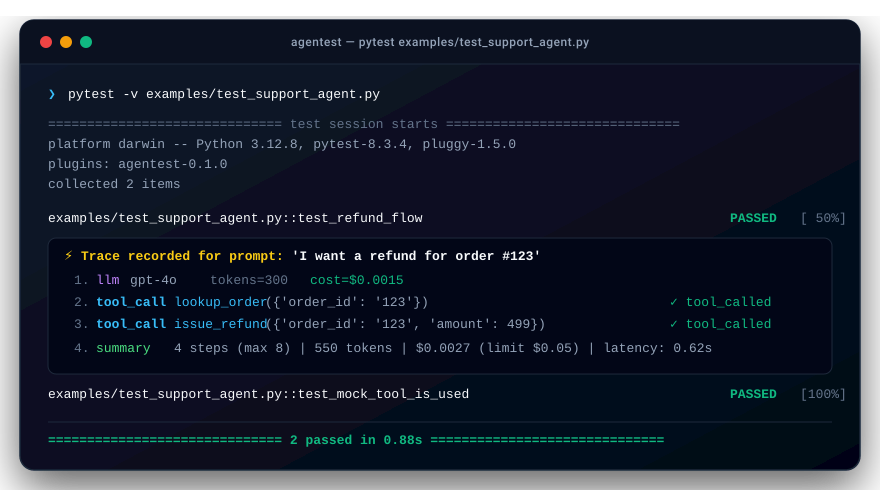

<div align="center">

# 🧪 agentest

### **pytest for AI Agents**
*Assert on what your agent did, not just what it said.*

[](https://github.com/iitking/agentest/actions/workflows/ci.yml)
[](https://www.python.org/downloads/)
[](https://docs.pytest.org/)
[](https://github.com/astral-sh/ruff)
[](LICENSE)
[](CONTRIBUTING.md)

<p align="center">
  <a href="#-why-agentest">Why agentest?</a> •
  <a href="#-terminal-demo">Demo</a> •
  <a href="#-tech-stack">Tech Stack</a> •
  <a href="#-quickstart">Quickstart</a> •
  <a href="#-core-assertions">Assertions</a> •
  <a href="#-architecture">Architecture</a> •
  <a href="#-build-plan">Roadmap</a> •
  <a href="#-contributing">Contributing</a>
</p>

</div>

---

## ⚡ Terminal Demo



---

## 💡 Why agentest?

LLM text outputs are **non-deterministic**, making traditional unit tests brittle and flaky:

```python
# ❌ Flaky & Brittle: Breaks when prompt or LLM wording slightly changes
assert "Your refund of $499 has been processed" in agent.run(prompt)
```

With **agentest**, you test execution behavior instead of text phrasing:

```python
# ✅ Deterministic & Robust: Asserts exactly what actions took place
assert tool_called(trace, "lookup_order", args={"order_id": "123"})
assert tool_called(trace, "issue_refund", args={"amount": 499})
assert not tool_called(trace, "delete_account")
assert max_steps(trace, 8)
assert max_cost(trace, usd=0.05)
```

### What You Can Test
- 🎯 **Tool Selection**: Did the agent call the right tool with expected arguments?
- 🛑 **Forbidden Tools**: Did it stay away from destructive operations (e.g., `delete_account`, `drop_table`)?
- 🔄 **Loop Prevention**: Did it get stuck repeating the same tool call with identical arguments?
- 💰 **Budget Guardrails**: Did it stay strictly under your dollar cost, token, and step budgets?
- ⏱️ **Latency Checks**: Did the agent finish execution within SLA limits?

---

## 🛠️ Tech Stack

| Component | Technology | Description |
|---|---|---|
| **Language** | Python 3.10+ | Clean modern dataclasses, structural typing, and PEP 585/604 annotations |
| **Testing Engine** | `pytest >= 7.0` | Integrated directly via `pytest11` entry points with markers and fixtures |
| **Linter & Formatter** | [Ruff](https://github.com/astral-sh/ruff) | Blazing-fast linting and import formatting |
| **Type Checker** | [Mypy](https://mypy-lang.org/) | Strict static type checking |
| **Packaging** | [Hatchling](https://hatch.pypa.io/) | Modern PEP 517/PEP 621 build backend and wheel target management |
| **CI / CD** | GitHub Actions | Automated multi-version matrix testing across Python 3.10, 3.11, 3.12, 3.13 |
| **Agent Ecosystem** | Framework-agnostic | Extensible adapter layer for LangGraph, CrewAI, AutoGen, OpenAI Agents SDK, and plain functions |

---

## 🚀 Quickstart

### 1. Installation

```bash
pip install agentest
```

### 2. Write your test

```python
# test_support_agent.py
from agentest import run_agent, tool_called, max_steps, max_cost
from my_agent import support_agent, TOOLS

def test_refund_flow():
    # Run agent and capture a normalized execution Trace
    trace = run_agent(support_agent, "I want a refund for order #123", tools=TOOLS)

    # Behavior assertions
    assert tool_called(trace, "lookup_order", args={"order_id": "123"})
    assert tool_called(trace, "issue_refund")
    assert not tool_called(trace, "delete_account")

    # Budget assertions
    assert max_steps(trace, 8)
    assert max_cost(trace, usd=0.05)
```

### 3. Run with pytest

```bash
pytest -v
```

---

## 🔍 Core Concepts

| Concept | Description |
|---|---|
| **Trace** | A normalized record of a single agent run: sequence of steps (LLM calls, tool calls, tool results, final answer) along with token count, cost (USD), and latency. |
| **Adapter** | Framework bridge that converts any agent runtime (LangGraph, CrewAI, AutoGen, plain Python callable) into a normalized `Trace`. |
| **Assertion** | Pure verification function returning a `Check` object with rich failure diagnostics (`tool_called`, `max_steps`, `max_cost`, etc.). |
| **Mock Tool** | Deterministic replacement for real APIs and databases so tests run in milliseconds without external side effects or costs. |
| **Replay** | Serializes a `Trace` to disk to re-run assertions in CI/CD without paying for LLM tokens. |

---

## 📊 Rich Failure Diagnostics

When an assertion fails, `agentest` doesn't just give you `AssertionError: False`. It prints a full chronological timeline of your agent's run:

```text
FAILED: expected tool 'issue_refund' to be called, but it was not
Trace for prompt: 'I want a refund for order #123'
  1. llm gpt-4o tokens=312 cost=$0.0016
  2. tool_call lookup_order({'order_id': '123'})
  3. llm gpt-4o tokens=180 cost=$0.0009
  4. final output: 'I cannot process this refund request.'
  total: 4 steps, 492 tokens, $0.0025
```

---

## 🏛️ Architecture

```
   Your Test (pytest)
          │
          ▼
   pytest Plugin (`pytest11`)
          │
          ├──▶ Adapter (Plain Python / LangGraph / CrewAI) ──▶ Agent Runtime
          │          │                                                │
          │          └──◀────── Trace Recorder (Steps) ───────────────┘
          ▼
     Assertions (`Check`)
          │
          ▼
   Timeline Reporter (Terminal / JSON / HTML)
```

### Writing a Custom Adapter

Supporting a new framework requires implementing a single class:

```python
# src/agentest/adapters/base.py
from abc import ABC, abstractmethod
from typing import Any, Callable
from agentest.trace import Trace

class Adapter(ABC):
    name: str

    @abstractmethod
    def run(
        self,
        agent: Any,
        prompt: str,
        *,
        tools: dict[str, Callable] | None = None,
        mock_tools: dict[str, Callable] | None = None,
    ) -> Trace:
        """Run the agent and return a normalized Trace."""
```

Adapters are auto-discovered through Python entry points, allowing plugins to live in external packages.

---

## 📂 Repository Layout

```
agentest/
├── .github/workflows/ci.yml    # Matrix CI across Python 3.10-3.13
├── assets/
│   └── demo.svg                # Visual terminal preview
├── src/agentest/
│   ├── __init__.py             # Public API exports
│   ├── trace.py                # Trace and Step dataclasses + timeline formatter
│   ├── runner.py               # run_agent() execution wrapper
│   ├── plugin.py               # pytest plugin hooks and fixtures
│   ├── assertions/
│   │   ├── base.py             # Check dataclass
│   │   ├── tools.py            # tool_called, tool_order, no_forbidden_tool
│   │   └── budget.py           # max_steps, max_cost, max_tokens
│   └── adapters/
│       ├── base.py             # Adapter abstract base class
│       └── plain_python.py     # Recorder & PlainPythonAdapter
├── examples/
│   ├── support_agent.py        # Demo agent implementation
│   └── test_support_agent.py   # Executable example tests
├── tests/
│   └── test_assertions.py      # Unit test suite
├── CONTRIBUTING.md
├── pyproject.toml
└── README.md
```

---

## 🗺️ Build Plan & Roadmap

- [x] **Phase 1: Core Architecture**
  - [x] Modern `pyproject.toml` layout with Hatchling backend
  - [x] GitHub Actions automated CI matrix (Python 3.10–3.13)
  - [x] `Trace` and `Step` dataclasses with `timeline()` formatting
  - [x] `PlainPythonAdapter` and `Recorder`
  - [x] Assertions: `tool_called`, `max_steps`, `max_cost`, `max_tokens`
  - [x] Pytest plugin skeleton with `@pytest.mark.agent` and `agent_runner` fixture

- [ ] **Phase 2: Behavioral Guardrails (In Progress)**
  - [ ] `tool_order` assertion (strict and relaxed sequence matching)
  - [ ] `no_forbidden_tool` assertion
  - [ ] `no_loop` repeated tool call cycle detection
  - [ ] `max_latency` timing constraints
  - [ ] LangGraph adapter (`LangGraphAdapter`)

- [ ] **Phase 3: Production & Replay**
  - [ ] Zero-cost offline trace replay (`replay.py`)
  - [ ] CrewAI and AutoGen adapters
  - [ ] Terminal color timeline and HTML/JSON report exports
  - [ ] MkDocs documentation site

- [ ] **Phase 4: Launch & Ecosystem**
  - [ ] PyPI publishing (`pip install agentest`)
  - [ ] PR cost diff bot GitHub Action
  - [ ] OpenAI Agents SDK & Pydantic AI adapters

---

## 🤝 Contributing

Contributions are very welcome! Whether adding a new assertion, writing an adapter for your favorite agent framework, or improving docs:

1. **Fork & Clone**:
   ```bash
   git clone https://github.com/iitking/agentest.git
   cd agentest
   ```
2. **Setup virtual environment**:
   ```bash
   python3 -m venv .venv && source .venv/bin/activate
   pip install -e ".[dev]"
   ```
3. **Verify tests & linting**:
   ```bash
   pytest
   ruff check .
   ```
4. **Submit a PR**: Check out [CONTRIBUTING.md](CONTRIBUTING.md) for full details and good first issues.

---

## 📜 License

Distributed under the **MIT License**. See [LICENSE](LICENSE) for details.

---

<div align="center">
  <b>Built with ❤️ by <a href="https://github.com/iitking">Nivesh Kumar Meena</a></b>
</div>
